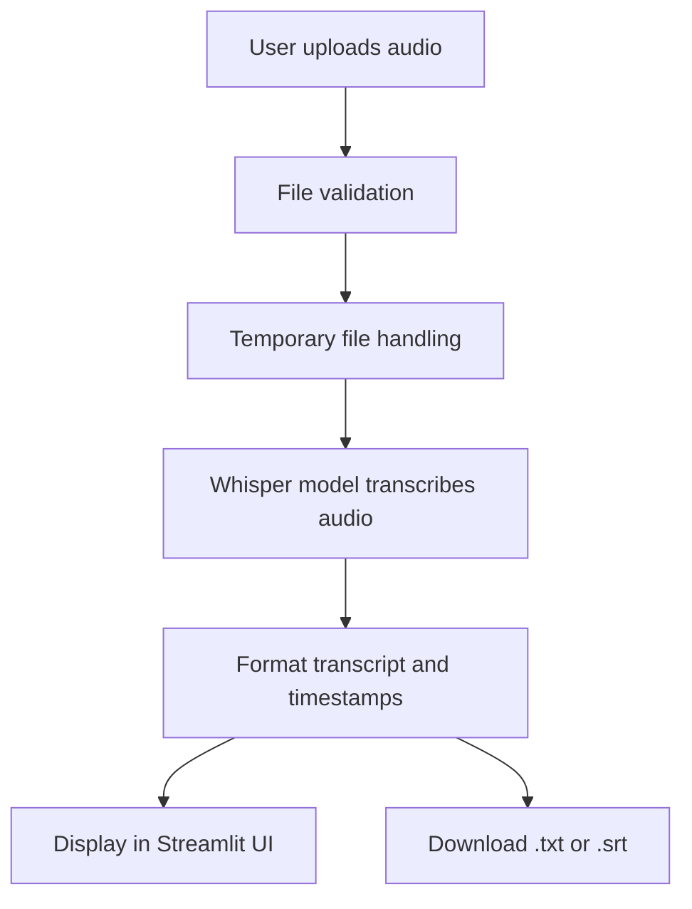

# ASR Tool — Speech-to-Text Transcription System

## Project Overview

This project is a local Automatic Speech Recognition (ASR) application built with Python, Streamlit, and Whisper-based transcription. It lets users upload an audio recording, choose a model and language, review a transcript, and export plain text or timed subtitles.

## Problem Statement

Many students and developers need a simple local speech-to-text tool for transcription tasks, interviews, lectures, and voice notes. Commercial services can be expensive or require cloud access. This project fills that gap by providing a local, transparent, and open-source transcription tool suitable for personal use and academic projects.

## Project Objectives

- Accept uploaded audio files in common formats.
- Validate the file before processing.
- Transcribe with a configurable Whisper model.
- Allow language selection and automatic language detection.
- Show a clean transcript and downloadable text output.
- Keep the code modular and testable.

## Features

- Audio upload for WAV, MP3, M4A, FLAC, and OGG files.
- File size and format validation.
- Language selection and model size selection.
- Whisper-based transcription with CPU inference.
- Copy-friendly transcript display.
- Download as TXT and SRT files.
- Error handling for invalid files and failed transcription runs.
- Responsive, two-column Streamlit transcription workspace.
- Audio preview, file details, and upload-size validation.
- Results stay visible while downloading or interacting with the page.
- Local processing with safe temporary-file cleanup when the workspace is cleared or a new recording is selected.

## Technologies and Tools Used

- Python 3.11+: application logic and orchestration.
- Streamlit: interactive web interface.
- faster-whisper: efficient Whisper inference.
- FFmpeg: audio decoding and validation.
- pytest: automated testing.
- Ruff: linter for code quality.
- Git: version control.
- Markdown: project documentation.

## System Architecture

The application is separated into three key areas:

- UI layer in app.py
- Model and transcription logic in asr/transcriber.py
- File validation and helper logic in asr/audio_utils.py

## Project Directory Structure

```text
ASR-Tool/
├── app.py
├── asr/
│   ├── __init__.py
│   ├── transcriber.py
│   └── audio_utils.py
├── tests/
│   ├── __init__.py
│   ├── test_transcriber.py
│   └── test_audio_utils.py
├── docs/
│   └── usage.md
├── requirements.txt
├── README.md
├── .gitignore
├── LICENSE
├── .streamlit/
│   └── config.toml
└── .venv/  (local only; excluded from Git)
```

## Prerequisites

- Python 3.11 or later
- FFmpeg installed and available on PATH
- Internet access for the first model download
- Enough disk space for Whisper model files
- CPU-only environment is supported

## Installation Instructions

### Linux/macOS

```bash
python3 -m venv .venv
source .venv/bin/activate
python -m pip install --upgrade pip
python -m pip install -r requirements.txt
```

### Windows PowerShell

```powershell
py -m venv .venv
.\.venv\Scripts\Activate.ps1
python -m pip install --upgrade pip
python -m pip install -r requirements.txt
```

## FFmpeg Installation

### Linux (Ubuntu/Debian)

```bash
sudo apt update
sudo apt install ffmpeg
```

### macOS

```bash
brew install ffmpeg
```

### Windows

Download FFmpeg from the official site or use winget:

```powershell
winget install Gyan.Dev.FFmpeg
```

Then confirm:

```bash
ffmpeg -version
```

## Launch the Application

From the project root:

```bash
streamlit run app.py
```

Open the URL shown in the terminal, such as http://localhost:8501.

## Step-by-Step Usage

1. Run the app with Streamlit.
2. Upload an audio file.
3. Select a model size and language.
4. Click Transcribe Audio.
5. Review the transcription output.
6. Download the transcript or SRT file.

## Example Input and Output

### Example input

A short WAV file containing spoken English.

### Example output

```text
Hello everyone, thank you for joining this demonstration today.
We are showing how the ASR tool converts spoken words into readable text.
```

## Supported Audio Formats

- WAV
- MP3
- M4A
- FLAC
- OGG

## ASR Model Choices and Language Support

The application supports Whisper model sizes such as:

- tiny
- base
- small
- medium
- large
- large-v3
- large-v3-turbo

Language selection includes English and several other languages supported by Whisper, including French, Spanish, German, Japanese, Mandarin, Arabic, and more. The app also allows the auto-detection option.

## Running Tests

```bash
pytest -q
```

## Known Limitations

- Large Whisper models may require significant disk space and memory.
- CPU inference can be slower on large files.
- Very noisy or clipped audio may reduce transcription quality.
- Some multilingual outputs can be imperfect without clear speech.

## Troubleshooting

### "ffmpeg not found"

Install FFmpeg and make sure it is available in PATH.

### "Unsupported audio format"

Use a supported input type and verify the extension.

### "Transcription failed"

Check that the file is valid, not empty, and not corrupted. Also verify the model downloads correctly.

### "Model download failed"

Check your internet connection and permissions for the model cache directory.

## Privacy Considerations

Uploaded audio is processed locally on your machine when the model is run. The project does not include any cloud API keys or external service credentials. However, audio files are still temporarily stored during processing and should be treated as sensitive content.

## Future Enhancements

- Add a batch transcription feature.
- Add speaker diarization.
- Improve a better UI with drag-and-drop controls.
- Add a local caching mechanism for model downloads.
- Add noise reduction and audio preprocessing options.

## License Information

This project is licensed under the MIT License. It is a permissive open-source license that allows reuse, modification, and distribution with attribution.

## GitHub Upload Instructions

1. Initialize Git:

```bash
git init
```

2. Add files:

```bash
git add .
```

3. Commit the project:

```bash
git commit -m "feat: implement ASR speech-to-text application"
```

4. Create a remote repository on GitHub and push:

```bash
git branch -M main
git remote add origin https://github.com/your-username/asr-tool.git
git push -u origin main
```

## Mermaid Architecture Diagram


